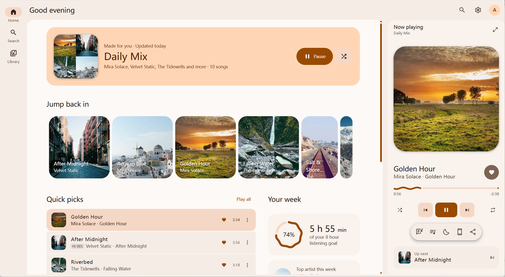
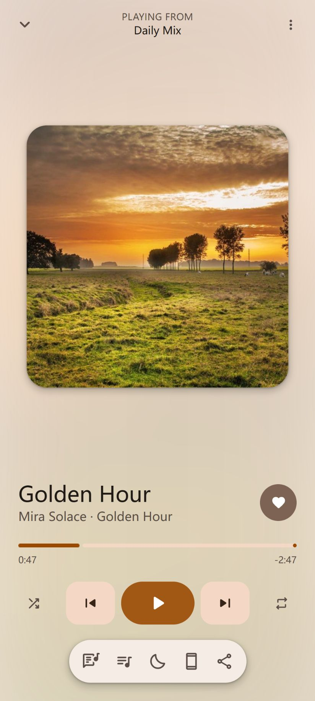
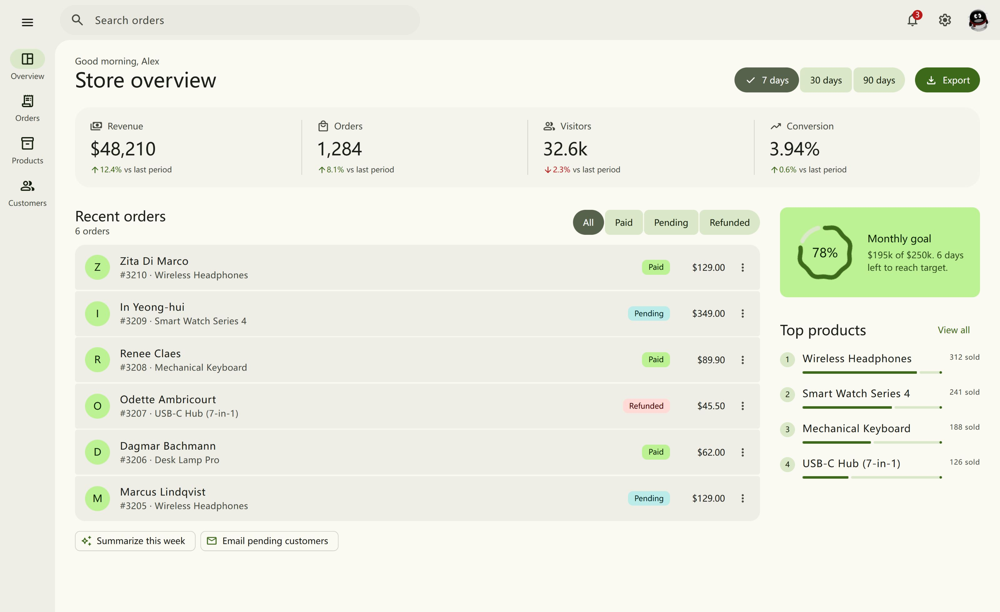
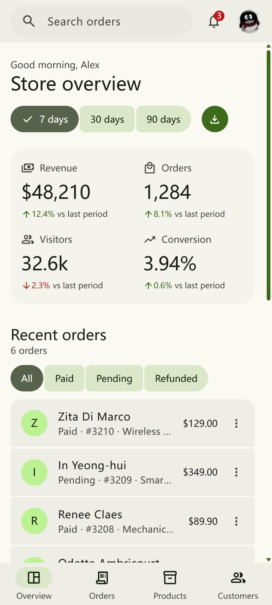
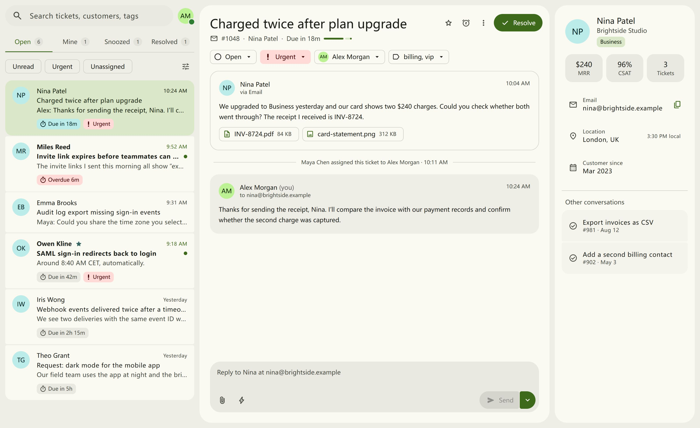
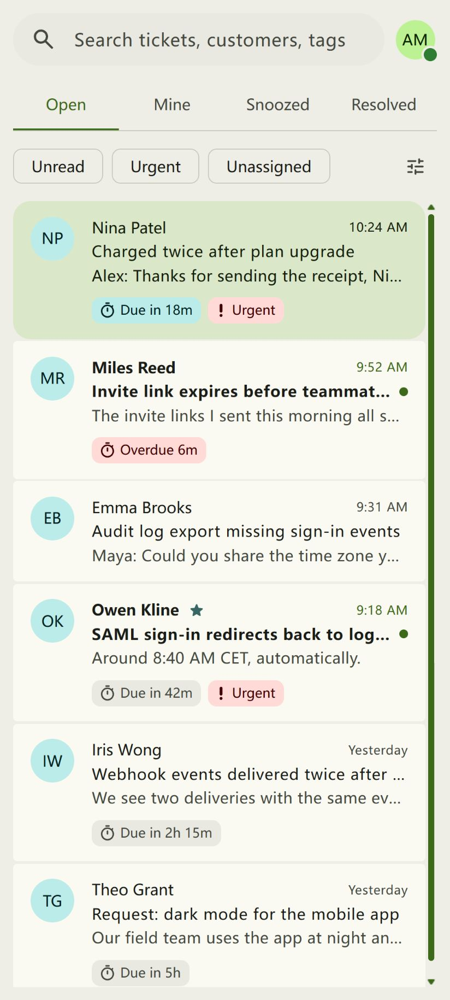

# Material You Tailwind

Material Design 3 Expressive components and application blocks for React and Tailwind CSS.

Add the components you need with the shadcn CLI, then make them your own. The source lives in your project, ready to customize—from individual buttons to a complete music player interface.

[Documentation](https://material.nanven.cn/docs) · [Components](https://material.nanven.cn/components) · [Blocks](https://material.nanven.cn/blocks) · [Colors & theming](https://material.nanven.cn/docs/colors) · [Changelog](https://material.nanven.cn/docs/changelog)

## Featured block: Music Player

<table>
  <tr>
    <td width="78%" valign="top">
      <a href="https://material.nanven.cn/blocks/music-player">
        <picture>
          <source media="(prefers-color-scheme: dark)" srcset="./docs/blocks/music-player-desktop-dark.jpg">
          <source media="(prefers-color-scheme: light)" srcset="./docs/blocks/music-player-desktop-light.png">
          
        </picture>
      </a>
    </td>
    <td width="22%" valign="top">
      <a href="https://material.nanven.cn/blocks/music-player">
        <picture>
          <source media="(prefers-color-scheme: dark)" srcset="./docs/blocks/music-player-mobile-dark.jpg">
          <source media="(prefers-color-scheme: light)" srcset="./docs/blocks/music-player-mobile-light.jpg">
          
        </picture>
      </a>
    </td>
  </tr>
</table>

[Live demo](https://material.nanven.cn/blocks/music-player) · [Source](./src/blocks/music-player.tsx)

## Analytics Dashboard

<table>
  <tr>
    <td width="78%" valign="top">
      <a href="https://material.nanven.cn/blocks/dashboard">
        <picture>
          <source media="(prefers-color-scheme: dark)" srcset="./docs/blocks/dashboard-desktop-dark.jpg">
          <source media="(prefers-color-scheme: light)" srcset="./docs/blocks/dashboard-desktop-light.jpg">
          
        </picture>
      </a>
    </td>
    <td width="22%" valign="top">
      <a href="https://material.nanven.cn/blocks/dashboard">
        <picture>
          <source media="(prefers-color-scheme: dark)" srcset="./docs/blocks/dashboard-mobile-dark.jpg">
          <source media="(prefers-color-scheme: light)" srcset="./docs/blocks/dashboard-mobile-light.jpg">
          
        </picture>
      </a>
    </td>
  </tr>
</table>

[Live demo](https://material.nanven.cn/blocks/dashboard) · [Source](./src/blocks/dashboard.tsx)

## Support Inbox

<table>
  <tr>
    <td width="78%" valign="top">
      <a href="https://material.nanven.cn/blocks/support-inbox">
        <picture>
          <source media="(prefers-color-scheme: dark)" srcset="./docs/blocks/support-inbox-desktop-dark.jpg">
          <source media="(prefers-color-scheme: light)" srcset="./docs/blocks/support-inbox-desktop-light.jpg">
          
        </picture>
      </a>
    </td>
    <td width="22%" valign="top">
      <a href="https://material.nanven.cn/blocks/support-inbox">
        <picture>
          <source media="(prefers-color-scheme: dark)" srcset="./docs/blocks/support-inbox-mobile-dark.jpg">
          <source media="(prefers-color-scheme: light)" srcset="./docs/blocks/support-inbox-mobile-light.jpg">
          
        </picture>
      </a>
    </td>
  </tr>
</table>

[Live demo](https://material.nanven.cn/blocks/support-inbox) · [Source](./src/blocks/support-inbox.tsx)

## Features

- **Material You styling.** Expressive shapes, ripple effects, elevation, and Material color roles.
- **Source you control.** Install individual components through the shadcn registry and edit them directly in your project.
- **Light and dark themes.** Built-in palettes, plus a theme generator for creating colors that fit your brand.
- **Composable React components.** TypeScript, Tailwind CSS v4, and Radix UI primitives.
- **From components to screens.** 33 UI components with documentation, examples, and application blocks.

## Quick start

Use a **React 19** project with **Tailwind CSS v4**.

### 1. Initialize shadcn

If your project does not have a `components.json` yet, initialize shadcn with CSS variables enabled:

```bash
npx shadcn@latest init
```

### 2. Register Material You and apply the theme

```bash
npx shadcn@latest registry add '@material-you=https://material.nanven.cn/r/{name}.json'
npx shadcn@latest add @material-you/material-theme
```

Apply the theme before adding components so Material color roles replace shadcn's default colors. Register the namespace first: components use it to resolve their dependencies.

### 3. Add components

```bash
npx shadcn@latest add @material-you/button @material-you/text-field
```

The CLI copies the source into your configured UI directory. Import it from there:

```tsx
import { Button } from '@/components/ui/button'

export function Example() {
    return <Button variant='tonal'>Make it yours</Button>
}
```

See the [installation guide](https://material.nanven.cn/docs/installation) for manual setup and the [color guide](https://material.nanven.cn/docs/colors) for theming.

## Components

Browse the [component documentation](https://material.nanven.cn/components) for previews, installation commands, and usage examples.

| Category   | Components                                                                                                                                                                                                                                                                                                                                                                                                                                                                                         |
| ---------- | -------------------------------------------------------------------------------------------------------------------------------------------------------------------------------------------------------------------------------------------------------------------------------------------------------------------------------------------------------------------------------------------------------------------------------------------------------------------------------------------------- |
| Actions    | [Button](https://material.nanven.cn/components/button), [Button Group](https://material.nanven.cn/components/button-group), [Toggle](https://material.nanven.cn/components/toggle), [Chip](https://material.nanven.cn/components/chip)                                                                                                                                                                                                                                                             |
| Inputs     | [Checkbox](https://material.nanven.cn/components/checkbox), [Radio Group](https://material.nanven.cn/components/radio-group), [Switch](https://material.nanven.cn/components/switch), [Slider](https://material.nanven.cn/components/slider), [Text Field](https://material.nanven.cn/components/text-field), [Search](https://material.nanven.cn/components/search), [Calendar](https://material.nanven.cn/components/calendar), [Time Picker](https://material.nanven.cn/components/time-picker) |
| Navigation | [Navigation Bar](https://material.nanven.cn/components/navigation-bar), [Navigation Rail](https://material.nanven.cn/components/navigation-rail), [Tabs](https://material.nanven.cn/components/tabs), [Toolbar](https://material.nanven.cn/components/toolbar)                                                                                                                                                                                                                                     |
| Content    | [Avatar](https://material.nanven.cn/components/avatar), [Badge](https://material.nanven.cn/components/badge), [Card](https://material.nanven.cn/components/card), [Carousel](https://material.nanven.cn/components/carousel), [Divider](https://material.nanven.cn/components/divider), [List](https://material.nanven.cn/components/list), [Scroll Field](https://material.nanven.cn/components/scroll-field)                                                                                     |
| Overlays   | [Dialog](https://material.nanven.cn/components/dialog), [Sheet](https://material.nanven.cn/components/sheet), [Popover](https://material.nanven.cn/components/popover), [Dropdown Menu](https://material.nanven.cn/components/dropdown-menu), [Context Menu](https://material.nanven.cn/components/context-menu), [Tooltip](https://material.nanven.cn/components/tooltip)                                                                                                                         |
| Feedback   | [Loading](https://material.nanven.cn/components/loading), [Progress](https://material.nanven.cn/components/progress), [Ripple](https://material.nanven.cn/components/ripple), [Snackbar](https://material.nanven.cn/components/snakebar)                                                                                                                                                                                                                                                           |

## Local development

Clone the repository and start the documentation site:

```bash
git clone https://github.com/BolshevikNanven/material-you-tailwind.git
cd material-you-tailwind
pnpm install
pnpm dev
```

Open [localhost:3000](http://localhost:3000).

| Command               | Description                                                         |
| --------------------- | ------------------------------------------------------------------- |
| `pnpm dev`            | Build the registry and start the development server.                |
| `pnpm build`          | Build the registry and the production site.                         |
| `pnpm start`          | Serve the production build.                                         |
| `pnpm lint`           | Run ESLint.                                                         |
| `pnpm registry:build` | Regenerate `registry.json` and the installable items in `public/r`. |

### Testing the local registry

The registry is generated from `src/components/ui`, `src/content/components`, and `src/app/globals.css`. Rebuild it after changing components or theme styles.

With the development server running, register its URL in a separate React 19 / Tailwind CSS v4 project initialized with shadcn:

```bash
npx shadcn@latest registry add '@material-you=http://localhost:3000/r/{name}.json'
npx shadcn@latest add @material-you/material-theme
npx shadcn@latest add @material-you/button
```

## Contributing

Bug reports, documentation improvements, new components, and blocks are welcome. [Open an issue](https://github.com/BolshevikNanven/material-you-tailwind/issues) to report a bug or discuss an idea, or submit a pull request.

- UI components live in `src/components/ui`, with documentation in `src/content/components`.
- Application blocks live in `src/blocks`.
- Include examples for UI changes and check both light and dark themes and responsive layouts.
- Run `pnpm lint` and `pnpm build` before submitting a pull request.

## Credits

Inspired by [shadcn/ui](https://ui.shadcn.com) and [Material Design 3](https://m3.material.io). Built with [Radix UI](https://www.radix-ui.com) and [Tailwind CSS](https://tailwindcss.com).

## License

[MIT](./LICENSE) © Nanven
