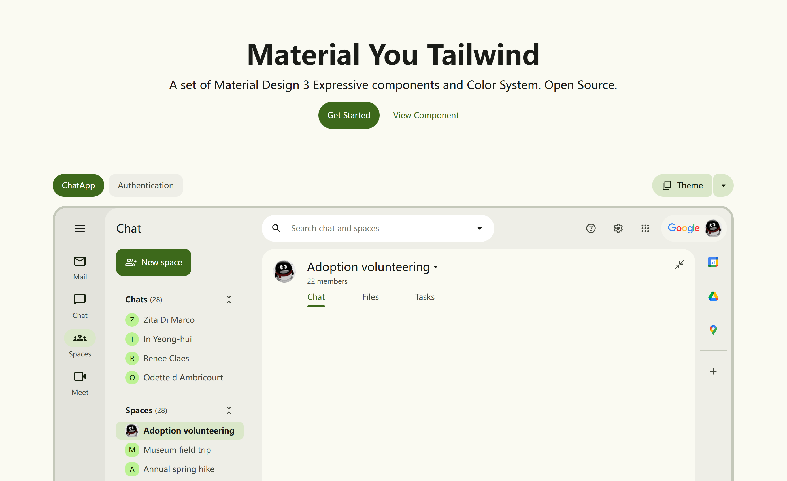

## Material You Tailwind

An implementation of the Material You design in Tailwind CSS.

Work in progress. Stay tuned!



## Install with shadcn

In a React 19 project with Tailwind CSS v4, run `npx shadcn@latest init` once if you do not have a `components.json` yet. Register the `@material-you` namespace, apply the Material theme so it replaces shadcn's default colors, then add the components you need.

```bash
npx shadcn@latest registry add '@material-you=https://material.nanven.cn/r/{name}.json'
npx shadcn@latest add @material-you/material-theme
npx shadcn@latest add @material-you/button
```

Components reference each other through the `@material-you` namespace, so it must be registered before adding them. See the [installation guide](https://material.nanven.cn/docs/installation) for details.

### Local registry

`pnpm registry:build` generates `registry.json` from the component sources, docs and `src/app/globals.css`, then runs `shadcn build` to write the catalog to `public/r`. `pnpm dev` and `pnpm build` run it first. Run it again after editing a component or the theme.

To try the local registry from a separate app, point the namespace at the dev server.

```bash
npx shadcn@latest registry add '@material-you=http://localhost:3000/r/{name}.json'
npx shadcn@latest add @material-you/calendar
```

## Document

Visit https://material.nanven.cn/

## Changelog

See the [Changelog](https://material.nanven.cn/docs/changelog) for component updates.

### Components

- [x] avatar
- [x] badge
- [x] button-group
- [x] button
- [x] calendar
- [x] card
- [x] carousel
- [x] checkbox
- [x] chip
- [x] context-menu
- [x] dialog
- [x] divider
- [x] dropdown-menu
- [x] list
- [x] loading
- [x] navigation
- [x] popover
- [x] radio-group
- [x] ripple
- [x] scroll-field
- [x] search
- [x] slider
- [x] snakebar
- [x] switch
- [x] text-field
- [x] <b>time-picker [new]</b>
- [x] toggle
- [x] tab
- [x] tooltip
- [x] toolbar
- [x] progress
